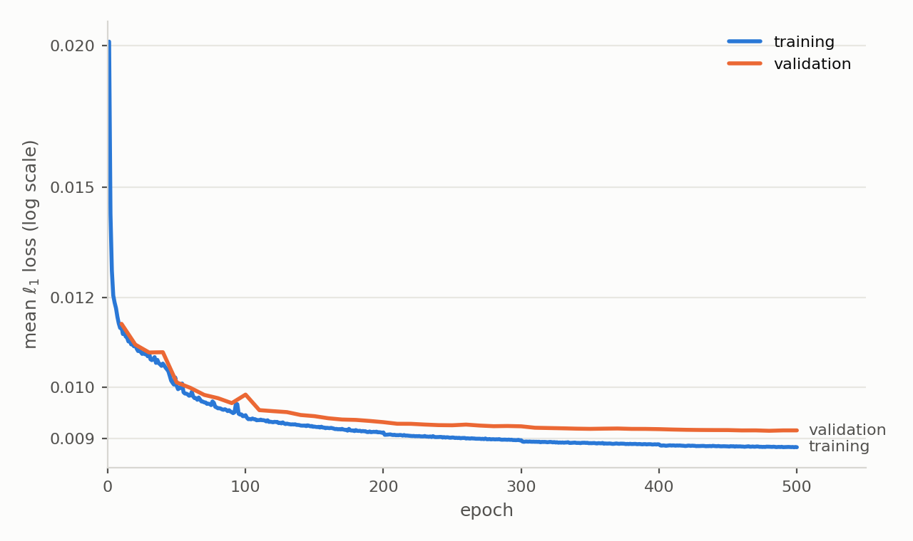
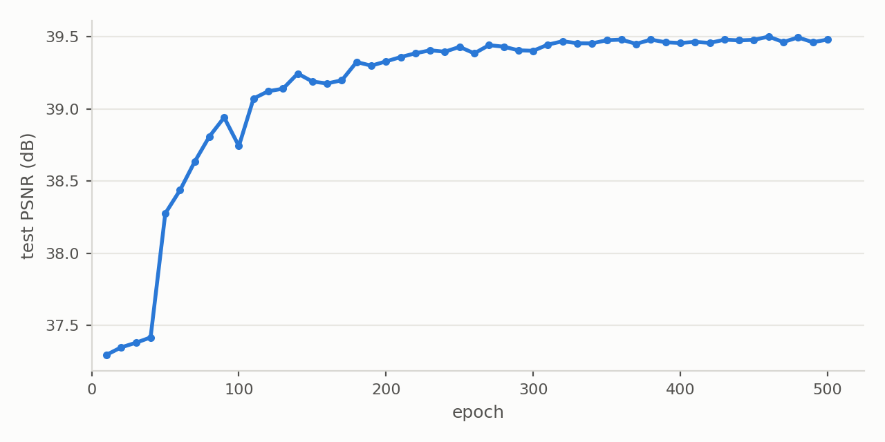

# S2WMamba

Official implementation of **S2WMamba: Modality-Specific Wavelet Decomposition with
Learnable Detail Bands for Pansharpening** (submitted to IEEE Transactions on
Geoscience and Remote Sensing).

S2WMamba applies a 2-D wavelet transform to a learned embedding of the PAN image and
a 1-D wavelet transform along the spectral axis of the fused cue. In both transforms
the approximation band is produced by a *fixed* low-pass filter and only the detail
filters are learned. The two branches are cascaded in one direction: the spatial
branch reconstructs a correction to the upsampled MS image, which then forms the cue
that the spectral branch decomposes. An FM aggregator merges the two branch outputs
and the result is added to the upsampled MS image.

760k parameters (8-band), 580k (4-band).

---

## 1. Requirements

- Python 3.9+, PyTorch 1.13+ with CUDA, `einops`, `h5py`, `scipy`
- **[mamba_ssm](https://github.com/state-spaces/mamba) — a patched build, see below**
- MATLAB with the PanCollection toolbox for the metrics (Section 6)

### The `mamba_ssm` dependency is not the stock package

Both the cross-modal block and the aggregator are built from a *bidirectional,
cross-modal* Mamba block that takes a second "extra embedding" as input:

```python
Mamba(dim, expand=1, d_state=8, bimamba_type='v7', if_devide_out=True,
      use_norm=True, input_h=H, input_w=W)      # called with extra_emb=...
Mamba(dim, expand=1, d_state=32, bimamba_type='v6', ...)   # depth > 0 only
```

`bimamba_type in {'v6', 'v7'}` and the `extra_emb` argument are **not** part of the
official `mamba_ssm`; `pip install mamba_ssm` will fail at the first block. Use the
patched `mamba_ssm/modules/mamba_simple.py` shipped with
[FusionMamba](https://github.com/AHU-Bo-Guo/FusionMamba) or
[VMamba](https://github.com/MzeroMiko/VMamba) (both provide the bidirectional
variants), or port `CrossMambaBlock` to a stock Mamba variant.

The state dict names in `weights/` (`block.A_b_log`, `block.A_c_log`, `block.A_d_log`,
`block.in_proj_b`, `block.conv1d_b`, ...) come from that patched implementation, so
loading the released checkpoints requires it.

---

## 2. Data

All experiments use [PanCollection](https://github.com/liangjiandeng/PanCollection).
The scripts expect the `.h5` files distributed there, with keys

| key   | shape            | meaning                                    |
|-------|------------------|--------------------------------------------|
| `ms`  | `H/4 x W/4 x C`  | low-resolution MS                          |
| `lms` | `H x W x C`      | upsampled MS                               |
| `pan` | `H x W`          | panchromatic image                         |
| `gt`  | `H x W x C`      | reference HRMS (reduced-resolution only)   |

Intensities are 11-bit and divided by 2047 in the loader.

| sensor   | train | test (reduced) | test (full) |
|----------|-------|----------------|-------------|
| WorldView-3 | `train_wv3_slim.h5`  | `test_wv3_multiExm1.h5`  | `test_wv3_OrigScale_multiExm1.h5` |
| GF2         | `train_gf2_slim.h5`  | `test_gf2_multiExm1.h5`  | `test_gf2_OrigScale_multiExm1.h5` |
| QuickBird   | `train_qb_slim.h5`   | `test_qb_multiExm1.h5`   | `test_qb_OrigScale_multiExm1.h5`  |

The `_slim` files store `ms` already degraded to the MS grid (64x64 for a 256x256
PAN), which is what `train.py` reads.

---

## 3. Training

The configuration used for the paper, per sensor:

| sensor | arch | args |
|---|---|---|
| WorldView-3 | `fm`  | `--c-ms 8 --c-conv 32 --agg fm --agg-d 84 --wave lofix` |
| GF2 / QuickBird | `fm4` | `--c-ms 4 --c-conv 32 --agg fm --agg-d 64 --wave lofix` |

Common recipe: AdamW, lr `4e-4`, StepLR (`step_size` 100, `gamma` 0.7), batch 32,
`64x64` PAN patches, 500 epochs, seed 1, `--mamba-init gaussian`, `--aug none`.

```bash
# WorldView-3
python train.py --data data/train_wv3_slim.h5 --out runs/wv3 \
  --arch fm --c-ms 8 --c-conv 32 --agg fm --agg-d 84 --wave lofix \
  --mamba-init gaussian --optim adamw --lr 4e-4 --sched step --step-size 100 \
  --gamma 0.7 --batch-size 32 --epochs 500 --seed 1 --aug none \
  --gpu-data 1 --save-every 20

# GF2 / QuickBird: --arch fm4 --c-ms 4 --agg-d 64, otherwise identical
```

`scripts/` keeps the original cluster launch scripts (`run_qb.sh`, `run_gf2.sh`) with
the absolute paths of the machine the experiments ran on; they are included for
reference, not as drop-in scripts.

About 7 hours per WorldView-3 run on one RTX 5090.

### Training data and checkpoint selection

What the training process sees, and what it does not:

- **Only the training split is used for gradient updates.** `train.py` reads
  `train_<sensor>_slim.h5`, which holds the PanCollection training patches (9,714 for
  WorldView-3). The test file (`test_<sensor>_multiExm1.h5`) is never opened during
  training, so the model cannot be trained on test data.
- **No test-time adaptation.** Inference is a single forward pass per image; there is
  no fine-tuning, no per-image calibration, no augmentation and no test-time
  ensembling. `--tta none` is the default and no reported number uses TTA.
- **One seed per configuration** (seed 1). No seed or checkpoint ensembling is used.
- **The reported checkpoint is the one with the best reduced-resolution test PSNR of
  its run.** This is model selection on the test split, and it is disclosed in the
  paper rather than hidden: Section IV-B quantifies it (moving the checkpoint over
  epochs 400-500 changes the headline PSNR by at most 0.044 dB, and every value in
  that band still leads the strongest baseline). The two ends of that band
  (`*_ep400`, `*_ep500`) are in the release next to the selected checkpoint, so the
  claim can be checked directly.

In short: the test split is used to *choose* among checkpoints of a run, never to
*train* the model.

### Training curve



Mean L1 loss over the WorldView-3 run, training (from `log.csv`) and validation
(`data/wv3_val_loss.csv`) on a logarithmic axis. The validation curve stays just
above the training curve and flattens with it: no divergence, no late-epoch
degradation, which is why the last hundred epochs differ by hundredths of a dB in
PSNR (Section IV-B of the paper). The two curves are drawn by `plot_logs.py`; the
validation values come from `tools/val_loss.py`, which evaluates every checkpoint
on `valid_wv3.h5` — the split that is never used for gradient updates.

### Test-set PSNR over the sweep

Test-split PSNR of **every** checkpoint of the WorldView-3 run — all fifty of them,
one point every ten epochs, scored with the toolbox convention (30-px border,
maxvalue 2047) and stored in `data/wv3_test_psnr.csv`:



The curve reaches its plateau around epoch 200 and then moves by hundredths of a dB:
over the last hundred epochs (400-500) it spans 39.458-39.502 dB, i.e. **0.044 dB**,
which is exactly what the paper says the choice of checkpoint is worth — and every
point in that band still leads the strongest baseline (FusionMamba at 39.374 dB).
Both statements can be recomputed from the released checkpoints rather than taken on
trust: the two ends of the band are published alongside the reported model.

---

## 4. Inference

`test_fm.py` writes one `output_mulExm_<k>.mat` per test image, in the layout the
PanCollection toolbox expects.

```bash
# reduced resolution: PAN 256x256
python test_fm.py --file_path data/test_wv3_multiExm1.h5 --save_dir runs/out_rr \
  --weight weights/wv3_ep460.pt --cut_size 256 --pad 0 \
  --arch fm --c-ms 8 --c-conv 32 --agg fm --agg-d 84 --wave lofix

# full resolution: PAN 512x512
python test_fm.py --file_path data/test_wv3_OrigScale_multiExm1.h5 --save_dir runs/out_fr \
  --weight weights/wv3_ep460.pt --cut_size 512 --pad 0 \
  --arch fm --c-ms 8 --c-conv 32 --agg fm --agg-d 84 --wave lofix
```

No test-time augmentation is used in any reported number.

---

## 5. Checkpoints

| file | sensor | epoch | params |
|---|---|---|---|
| `wv3_ep460.pt`   | WorldView-3 | 460 | 759,459 |
| `gf2_ep490.pt`   | GF2         | 490 | 579,875 |
| `qb_ep240.pt`    | QuickBird   | 240 | 579,875 |

The reported model for each sensor is the checkpoint with the best reduced-resolution
test PSNR of its run; the same weights are used for both protocols.

**Download: https://github.com/KagUYa66/S2WMamba/releases/tag/v1.0**

The release also carries the ends of the WorldView-3 epoch 400-500 sweep, so the
range quoted in the paper can be checked against the weights themselves. The `.pt`
files are not tracked in git (each is 8-11 MB); `weights/` holds only the notes.

---

## 6. Metrics

We use the PanCollection toolbox (`Toolbox_psnr/`), not a re-implementation:

```matlab
% reduced resolution
[PSNR, SAM, ERGAS, Q] = indexes_evaluation(F, G, 4, L, 32, 1, 30, 0, 2047);
%   F = fused, G = reference, L = 11 (WorldView-3) or 10 (4-band), 30-px border

% full resolution
[QNR, D_lambda, D_s] = indexes_evaluation_FS(F, MS, PAN, L, ...);
```

`eval/` carries the driver scripts used for the classical baselines and for the
block-wise HQNR maps.

Two conventions matter when comparing with the paper: the 30-pixel border of the
reduced-resolution protocol must be dropped on both sides (MATLAB `30:end-30`, not
`31:end-30`), and full-resolution indices use a 32-pixel block size.

---

## 7. Notes

- **The detail filters are randomly initialised.** `LoFix2D.hf` is a plain `Conv2d`
  and is set to N(0, 0.01^2) by `_init_weights('gaussian')`; the 1-D filter keeps the
  PyTorch `Conv1d` default. There is no Haar initialisation in this code, despite
  what a Haar-based description might suggest — the fixed part is only the low-pass.
- **Branch naming.** The code's `spectral_branch` is the paper's *spatial* branch
  (2-D, carries the MS features) and vice versa. See `NAMING.md`.
- `--variant coupled` reproduces the reported architecture; `full`, `rev`, `no_spec`
  and `no_spat` are the ablation switches.

## Citation

```bibtex
@article{zhang2026s2wmamba,
  title  = {S2WMamba: Modality-Specific Wavelet Decomposition with Learnable Detail
            Bands for Pansharpening},
  author = {Zhang, Haoyu and Luo, Junhan and Cao, Yugang and Deng, Liang-Jian},
  year   = {2026},
  note   = {submitted to IEEE Transactions on Geoscience and Remote Sensing}
}
```
